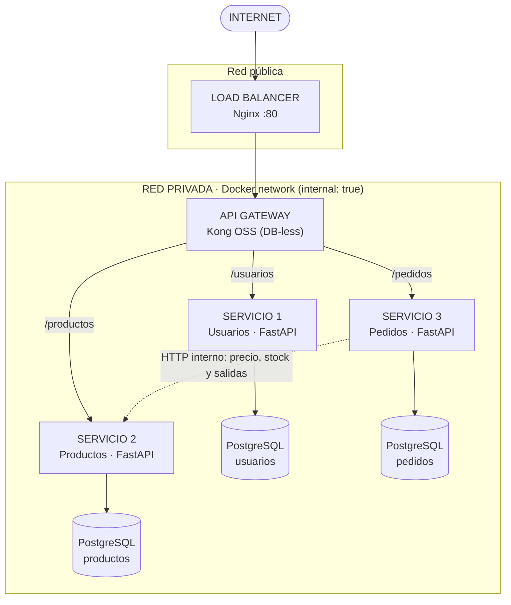

# Arquitectura del Sistema de Gestión para Restaurante

Este documento describe la arquitectura **implementada** en este repositorio y explica
cómo el diseño original (monolito Spring Boot + Angular) se adecuó a la arquitectura del
laboratorio de microservicios: Nginx → Kong → 3 servicios FastAPI → una base PostgreSQL por servicio,
todo en una red privada y levantado con un solo comando.

## 1. Qué cambió respecto al diseño de la exposición

| Aspecto | Diseño original (exposición) | Arquitectura actual (laboratorio) |
|---|---|---|
| Estilo | Monolito de tres capas | **3 microservicios independientes** |
| Backend | Spring Boot + JPA | **FastAPI + Uvicorn + Pydantic + SQLAlchemy** |
| Base de datos | Una PostgreSQL | **Una PostgreSQL por servicio** (3 en total) |
| Entrada | Nginx → Angular y proxy `/api` | **Nginx** (balanceador) → **Kong** (API Gateway) → servicios |
| Rutas | `/api/...` | `/usuarios`, `/productos`, `/pedidos` (prefijos que enruta Kong) |
| Red | Compose con 3 contenedores | Red `privada` con `internal: true`; solo Nginx publica el puerto 80 |
| Eventos | `ApplicationEvent` de Spring | Bus de eventos en memoria dentro del servicio de pedidos |
| Calidad | No definida | Ruff, pytest (cobertura ≥ 80 %), Bandit y Locust, con CI en GitHub Actions |
| Contenedores | `compose.yaml` con 3 servicios | `docker-compose.yml` con 8 contenedores y healthchecks en las bases |

Lo que **no cambia**: los cuatro roles, los estados del pedido
(Pendiente → En preparación → Listo → Entregado), las 9 entidades, JWT, el precio guardado en el
detalle del pedido, el stock calculado con movimientos y la regla "los permisos se validan en el backend".

## 2. Diagrama



Versión en texto:

```
 INTERNET
    │  http://localhost  (único puerto publicado: 80)
    ▼
 ┌────────┐
 │ Nginx  │  load balancer
 └───┬────┘
 ╔═══▼═══════════════════ red privada (internal: true) ═══════════════════╗
 ║  ┌──────┐   /usuarios   ┌───────────┐   ┌────────────────┐             ║
 ║  │ Kong │──────────────▶│ usuarios  │──▶│ db-usuarios    │ PostgreSQL  ║
 ║  │ (GW) │   /productos  ├───────────┤   ├────────────────┤             ║
 ║  │      │──────────────▶│ productos │──▶│ db-productos   │ PostgreSQL  ║
 ║  │      │   /pedidos    ├───────────┤   ├────────────────┤             ║
 ║  │      │──────────────▶│ pedidos   │──▶│ db-pedidos     │ PostgreSQL  ║
 ║  └──────┘               └─────┬─────┘   └────────────────┘             ║
 ║                               └── HTTP interno ──▶ productos           ║
 ╚════════════════════════════════════════════════════════════════════════╝
```

## 3. Flujo de una petición

Ejemplo: el cajero consulta los avisos con `GET http://localhost/pedidos/notificaciones`.

1. El cliente llama a `http://localhost/pedidos/notificaciones`; Nginx es el único puerto publicado.
2. Nginx reparte la petición hacia el API Gateway (`upstream gateway → kong:8000`) y le pasa la IP real en `X-Real-IP`.
3. Kong enruta por prefijo (`/pedidos`) hacia `http://pedidos:8000` y aplica el límite de tráfico (6000 peticiones/min por IP).
4. El servicio de pedidos valida el JWT, comprueba que el rol sea CAJERO o ADMIN y consulta **su propia** base de datos.
5. La base `db-pedidos` solo se alcanza dentro de la red privada.

## 4. Servicios y entidades

Las 9 entidades del diseño se reparten así; ningún servicio consulta la base de datos de otro.

| Servicio | Responsabilidad | Entidades (tablas) | Base de datos |
|---|---|---|---|
| **usuarios** | Login, emisión de JWT, roles y gestión de usuarios | `Rol`, `Usuario` | `db-usuarios` |
| **productos** | Menú, categorías e inventario por movimientos | `Categoria`, `Producto`, `MovimientoInventario` | `db-productos` |
| **pedidos** | Mesas, pedidos, estados, pagos y avisos al cajero | `Mesa`, `Pedido`, `DetallePedido`, `Pago` (+ `Notificacion`) | `db-pedidos` |

`Notificacion` no estaba entre las 9 entidades del diseño: es el almacén del aviso al cajero que genera el evento "pedido listo".

Entre servicios solo hay **referencias lógicas por id** (por ejemplo `Pedido.mesero_id` y `DetallePedido.producto_id`), sin claves foráneas entre bases.

### Endpoints

Todos devuelven JSON. `Autenticado` = cualquier rol con token válido.

| Método y ruta | Quién puede | Descripción |
|---|---|---|
| `GET /usuarios/health` | público | Estado del servicio y su base |
| `POST /usuarios/login` | público | Devuelve el JWT |
| `GET /usuarios/me` | Autenticado | Datos del usuario del token |
| `GET /usuarios`, `GET /usuarios/{id}` | ADMIN | Consultar usuarios |
| `POST /usuarios` | ADMIN | Crear usuario con su rol |
| `DELETE /usuarios/{id}` | ADMIN | Desactivar (no se borra) |
| `GET /productos/health` | público | Estado |
| `GET /productos`, `GET /productos/{id}` | Autenticado | Menú con precio y stock calculado |
| `POST/PUT/DELETE /productos…` | ADMIN | Alta, cambio y baja lógica |
| `GET /productos/categorias` | Autenticado | Listar categorías |
| `POST /productos/categorias` | ADMIN | Crear categoría |
| `POST /productos/{id}/movimientos` | ADMIN o token de servicio | Entrada, salida o ajuste |
| `GET /productos/{id}/movimientos` | ADMIN | Historial con stock resultante |
| `GET /pedidos/health` | público | Estado |
| `GET /pedidos/mesas` | Autenticado | Listar mesas |
| `POST /pedidos/mesas` | ADMIN | Crear mesa |
| `POST /pedidos` | MESERO, ADMIN | Crear pedido |
| `GET /pedidos?estado=…` | Autenticado | Tablero de cocina; el mesero solo ve los suyos |
| `GET /pedidos/{id}` | Autenticado | Detalle (mesero: solo propios) |
| `PATCH /pedidos/{id}/estado` | según transición | Ver tabla de estados |
| `POST /pedidos/{id}/pago` | CAJERO, ADMIN | Validar el pago |
| `GET /pedidos/notificaciones` | CAJERO, ADMIN | Avisos "pedido listo" |
| `POST /pedidos/notificaciones/{id}/leida` | CAJERO, ADMIN | Marcar aviso como leído |
| `GET /pedidos/ventas` | ADMIN | Total de ventas y cantidad de pagos |

### Estados del pedido

| Cambio | Rol que puede hacerlo |
|---|---|
| Pendiente → En preparación | COCINA, ADMIN |
| En preparación → Listo | COCINA, ADMIN |
| Listo → Entregado | MESERO (solo su pedido), ADMIN |

Cualquier otra transición responde 409. Un pedido solo se cobra cuando está Listo o Entregado, y el monto debe ser igual al total.

## 5. Comunicación entre servicios

Al crear un pedido, `pedidos` necesita el precio y el stock, que son datos de `productos`. Lo hace **por HTTP dentro de la red privada** (`http://productos:8000`), sin pasar por Kong y sin tocar la base de productos:

1. Reenvía el JWT del mesero para `GET /productos/{id}` (cualquier rol puede consultar el menú) y valida que el producto exista, esté activo y tenga stock.
2. Guarda el pedido con el nombre y el precio **del momento**.
3. Registra una `SALIDA` por producto con `POST /productos/{id}/movimientos`, autenticada con `X-Service-Token`.
4. Si una salida falla, devuelve al inventario las que ya se hicieron (movimientos `ENTRADA` de compensación) y deshace el pedido.

Si `productos` no responde, `pedidos` contesta **503** en vez de dejar datos a medias.

## 6. Eventos (versión ligera)

El diseño original usaba eventos de Spring. Se conserva la idea con un bus en memoria (`pedidos/app/eventos.py`):

| Evento | Productor | Suscriptores |
|---|---|---|
| `pedido.creado` | crear pedido | auditoría (log) |
| `pedido.estado_cambiado` | cambiar estado | auditoría (log) |
| `pedido.listo` | cambiar estado a Listo | **aviso al cajero** (fila en `notificaciones`) |

El tablero de cocina es la consulta `GET /pedidos?estado=PENDIENTE&estado=EN_PREPARACION`. Sin Kafka: la base de datos es la fuente de verdad y un suscriptor con error se registra en el log sin tumbar la operación.

## 7. Seguridad

| Medida | Dónde | Cómo |
|---|---|---|
| Un solo puerto publicado | `docker-compose.yml` | Solo `nginx` tiene `ports`; Kong, servicios y bases no |
| Red privada | `docker-compose.yml` | Red `privada` con `internal: true`: sin salida a Internet ni acceso desde fuera |
| Una BD por servicio | `docker-compose.yml` | Tres contenedores PostgreSQL, cada uno con su usuario, contraseña y volumen |
| Autenticación | `usuarios/app/security.py` | JWT HS256 con expiración; contraseñas con bcrypt |
| Autorización | cada servicio | El rol del token se comprueba en el backend en cada endpoint |
| Secretos fuera de Git | `.env` | Solo `.env.example` se versiona; `docker compose` falla si falta una variable |
| Procesos sin root | `*/Dockerfile` | `USER appuser` |
| Límite de tráfico | `kong/kong.yml` | Plugin `rate-limiting` por IP real |
| Código sin vulnerabilidades críticas | CI | `bandit -r app` |

Matriz de permisos por rol (resumen):

| Acción | ADMIN | MESERO | COCINA | CAJERO |
|---|:-:|:-:|:-:|:-:|
| Gestionar usuarios, productos, mesas y stock | ✔ | | | |
| Ver menú y mesas | ✔ | ✔ | ✔ | ✔ |
| Crear pedidos | ✔ | ✔ | | |
| Ver pedidos | todos | los suyos | todos | todos |
| Pasar a En preparación / Listo | ✔ | | ✔ | |
| Marcar Entregado | ✔ | los suyos | | |
| Validar pagos y ver avisos | ✔ | | | ✔ |
| Ver ventas | ✔ | | | |

Limitaciones de seguridad conocidas (prototipo): el secreto JWT y el token de servicio se comparten por variables de entorno; la autenticación no se delega a Kong (cada servicio valida el token); no hay HTTPS (se terminaría en Nginx en un despliegue real).

## 8. Requisitos de calidad con métricas

| Atributo | Requisito medible | Herramienta | Comando (en la carpeta de cada servicio) |
|---|---|---|---|
| Mantenibilidad | 0 errores de estilo ni advertencias | Ruff | `ruff check . && ruff format --check .` |
| Fiabilidad | Cobertura de pruebas ≥ 80 % y todas las pruebas en verde | pytest + httpx + pytest-cov | `pytest --cov=app --cov-fail-under=80` |
| Seguridad (código) | 0 vulnerabilidades críticas | Bandit | `bandit -r app` |
| Seguridad (red) | Bases de datos y Kong inaccesibles desde el anfitrión | `scripts/verificar.sh` | `./scripts/verificar.sh` |
| Desempeño | Respuesta p95 ≤ 2 s con 100 usuarios y 0 fallos | Locust | `locust -f pruebas_carga/locustfile.py --headless -u 100 -r 10 -t 30s -H http://localhost` |
| Disponibilidad | Cada servicio expone `/health` que comprueba su BD | pytest + `verificar.sh` | incluido en las pruebas |
| Portabilidad | Todo el sistema arranca con un comando | Docker Compose | `docker compose up --build` |

## 9. Trazabilidad con el laboratorio

| Entregable del laboratorio | Dónde está |
|---|---|
| Repositorio Git con código y `docker-compose.yml` | Raíz del repositorio |
| Diagrama de la arquitectura implementada | Sección 2 de este documento |
| Requisitos de calidad con métricas | Sección 8 |
| Evidencias: pytest, Ruff, Bandit y Locust | Se generan con los comandos de la sección 8 y se guardan en `resultados/` (ver `README.md`) |
| Demostración en vivo | Flujo de demostración del `README.md` + `scripts/verificar.sh` |

| Fase del laboratorio | Cumplimiento |
|---|---|
| 1. Entorno | Estructura `usuarios/`, `productos/`, `pedidos/`, `nginx/`, `kong/` y CI |
| 2. Servicios | 3 servicios FastAPI con sus endpoints y `/health` |
| 3. Datos y red | Una PostgreSQL por servicio dentro de la red `internal: true` |
| 4. Entrada | Kong DB-less (`KONG_DATABASE=off`, `KONG_DECLARATIVE_CONFIG`) y Nginx como balanceador, montados como volúmenes |
| 5. Calidad | Ruff, pytest, Bandit y Locust |

## 10. Pendientes y decisiones abiertas

- **Frontend Angular**: no se construyó. Cuando se haga, será un cuarto contenedor tras Nginx; Nginx serviría la aplicación en `/` y enviaría `/usuarios`, `/productos` y `/pedidos` a Kong.
- **Migraciones con Alembic**: está en las dependencias, pero hoy las tablas se crean con `create_all` al arrancar. Para cambios de esquema en producción hay que pasar a migraciones.
- **Copias de seguridad** (`pg_dump` / `pg_restore`): ahora son tres bases; el procedimiento diseñado debe repetirse por cada una y sigue sin probarse.
- **Consistencia entre servicios**: el descuento de inventario y el pedido no están en una transacción distribuida; se usa compensación. Un fallo del proceso entre ambos pasos podría dejar una salida sin pedido.
- **Réplicas**: Nginx ya balancea hacia un `upstream` con un solo servidor (Kong). Para repartir carga entre varias réplicas de Kong hay que levantarlas y añadirlas a ese `upstream`; hoy el sistema corre con una réplica de cada pieza.
- **Máquinas virtuales**: se mantiene la decisión de la exposición de usar Docker y no VM.
